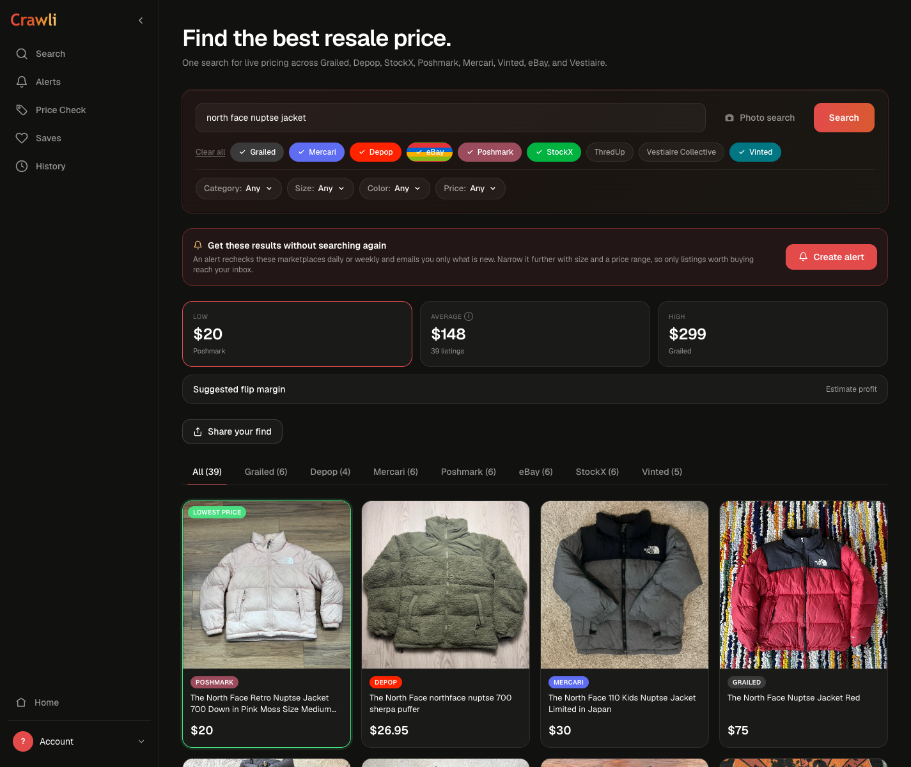
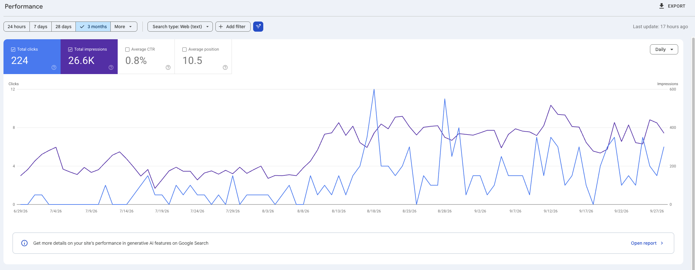
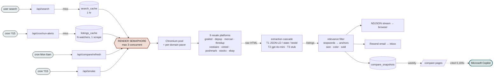
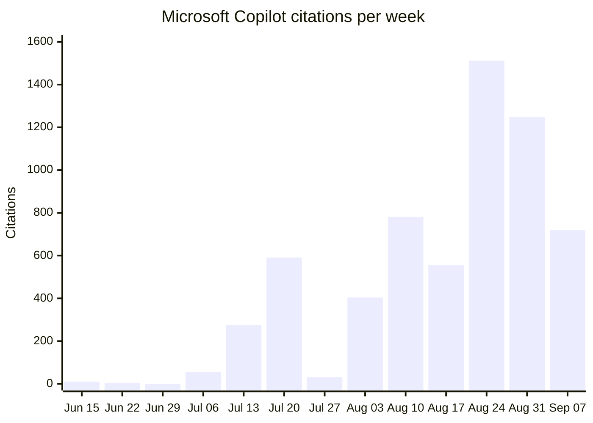

# Crawli

**One search across 9 secondhand fashion marketplaces: scraped live, filtered for relevance and price-compared in about 7 seconds.**

I built and ran Crawli solo, in production, from May to September 2026. All 9 platforms were still fully functional when I voluntarily shut it down. I wrote up what worked and what didn't. That write-up is the [full teardown](#full-teardown) below.



<p align="center">
  <a href="#what-i-built"></a>
  <a href="#engineering-highlights"></a>
  <a href="#data--decisions"></a>
  <a href="#building-with-ai"></a>
  <a href="#results--lessons"></a>
  <a href="#stack--repo-map"></a>
  <a href="#full-teardown"></a>
</p>

---

## What I built

- **A search engine over 9 marketplaces:** Grailed, Depop, Mercari, ThredUp, Vestiaire, Vinted, Poshmark, StockX and eBay. A Next.js app fans each query out to a Python scraping sidecar (crawl4ai + Playwright) and streams results back over NDJSON as each platform returns.
- **Product features on top of search:** price alerts on a 15-minute cron, saved searches, a watchlist that detects sold or removed listings, sold-price comps, and a resale margin calculator covering 7 platforms' fee structures.
- **A real business layer:** Stripe subscriptions plus prepaid credit packs, Supabase auth and Postgres with row-level security, and transactional email through Resend.
- **An SEO and AI-search surface:** 33 live-price compare pages and a 116-post blog, all with structured data.
- **Production operations, by myself:** one Hetzner VPS running nginx and systemd, monitored with Sentry, UptimeRobot and a self-healing smoke test.

## Engineering highlights

**1. Rebuilt the search pipeline: about 10× cheaper, 8× faster, 12× more results.**
The first version used Firecrawl to find around 20 listing URLs per platform, then scraped 10 of them one by one. That took a 60-second median and returned about 6 usable listings. I replaced it with one render of each platform's own search page and a per-platform grid extractor: about 7 seconds, about 75 listings, and zero paid API credits.
→ [`crawl4ai-service/search_page_extractors.py`](crawl4ai-service/search_page_extractors.py) · [`lib/scraper.ts`](lib/scraper.ts)

**2. Took price accuracy from about 70% to about 99% by putting deterministic parsing ahead of the LLM.**
Sending whole pages to an LLM picked the wrong price about 30% of the time, because shipping costs, related items and "last sale" prices sat on the same page. I built a three-tier cascade:
1. **Structured parsers first**, five strategies across nine sites: JSON-LD, `__NEXT_DATA__` framework state, RSC payload regex, `data-testid` and `og:` tags.
2. **gpt-4o-mini as a fallback**, run only on scoped page regions.
3. **A stub** that never invents a price.

→ [`crawl4ai-service/structured_extractors.py`](crawl4ai-service/structured_extractors.py)

**3. Relevance filtering that understands brands.**
Each query goes through tokenization, then stopwords, then *anchor* tokens that must all appear in a listing title. That's what stops "messi jersey" from matching a Ronaldo jersey. Brand aliases like *bape* = *A Bathing Ape* are expanded by an LLM and cached for 30 days. I worked through a long tail of edge cases: possessives, model numbers versus size numbers, and trading cards showing up in jersey searches. I also documented the one query shape that is *provably* unfixable with this design, instead of shipping a fake fix.
→ [`lib/parse.ts`](lib/parse.ts) · [`lib/queryExpansion.ts`](lib/queryExpansion.ts)

**4. Concurrency control and self-healing.**
An unbounded `Promise.all` over the platforms crashed Playwright's driver, and every scrape after that returned null with no error. I added three stacked concurrency limits and a per-domain politeness pacer that waits *outside* the render semaphore. I also added a smoke endpoint that runs a real search and returns 503 on an empty result, wired to auto-restart the sidecar. It catches the "alive but wrong" failures that uptime checks and Sentry both miss.
→ [`crawl4ai-service/main.py`](crawl4ai-service/main.py) · [`app/api/smoke/route.ts`](app/api/smoke/route.ts)

**5. Payments that never double-grant.**
Stripe delivers webhooks at least once, and granting credits isn't idempotent. Each event is recorded in a ledger table *before* it's processed, and that record is deleted if processing fails, so Stripe's retry runs it again instead of being silently skipped.
→ [`app/api/webhooks/stripe/route.ts`](app/api/webhooks/stripe/route.ts) · [`docs/migrations/stripe-webhook-idempotency.sql`](docs/migrations/stripe-webhook-idempotency.sql)

**6. Six caching layers, from in-memory to Postgres.**
Cache keys are normalized while the query is sent to platforms unchanged, and empty results are never cached. Repeat renders dropped from 9.1s to 9ms, and 50 alert subscribers on the same query cost one scrape.
→ [`lib/searchCache.ts`](lib/searchCache.ts)

## Data & decisions

I tried to make the big calls from measurements rather than hunches:

- **Benchmarks before switching anything.** I ran a bake-off over 72 URLs across 2 scraping engines before changing scrapers, and a concurrency benchmark before tuning limits. → [`archive/scripts/engine_bakeoff.py`](archive/scripts/engine_bakeoff.py) · [`scripts/bench-sidecar-concurrency.py`](scripts/bench-sidecar-concurrency.py)
- **Unit economics.** I modeled cost per search from real usage and brought it from $0.128 down to **$0.006**, a 21× reduction. → [`scripts/cogs-per-search.mjs`](scripts/cogs-per-search.mjs)
- **Funnel and cohort analysis in SQL.** 80% of signups ran a search, but only about 12% came back on a second day. That showed the problem was retention, not acquisition or pricing.
- **I killed a pricing change before writing any code.** A proposed change would have raised prices about 5×. Every paying customer had converted on *day zero*, not when they hit the free-tier limit, so I didn't ship it.
- **I cut a background job by 94%** after 30 days of Search Console data showed the feature earned about 5 clicks a month.
- **I found 6,189 Microsoft Copilot citations** in Bing data, against 224 Google clicks over roughly the same three months. That changed how I judged the whole SEO program (see [§14](#14--the-ai-citation-channel)).
- **Marketing ran as logged experiments**, each with a kill criterion written down before launch. → [`docs/planning/COMPETITIVE_POSITIONING.md`](docs/planning/COMPETITIVE_POSITIONING.md) §6



## Building with AI

I built Crawli with Claude Code as my main development environment, and I treated the AI workflow as something to engineer, not just a chat window:

- **Project memory.** [`CLAUDE.md`](CLAUDE.md) plus a four-doc system means every session starts from the current state and known pitfalls instead of rediscovering them. The four docs are [`HANDOFF`](docs/HANDOFF.md), [`PITFALLS`](docs/core/PITFALLS.md), [`PLATFORM_STATUS`](docs/core/PLATFORM_STATUS.md) and [`SYSTEM_DESIGN`](docs/core/SYSTEM_DESIGN.md). The pitfalls file records *why*, not just what, so mistakes don't repeat.
- **Spec → plan → subagent execution.** Medium-sized features went through these steps: brainstorm, written spec, task-by-task plan, isolated git worktree, then an implementer subagent per task with a review gate for spec compliance and code quality. The condensed specs, including the alternatives I rejected, are in [`docs/ARCHIVED_SPECS.md`](docs/ARCHIVED_SPECS.md).
- **Tools instead of copy-paste.** I connected 7 MCP servers (Supabase, Search Console, GA4/PageSpeed, Playwright, Resend, n8n and a GEO auditor), so the agent queried production data itself. Most of the decisions above started as one of those queries.
- **LLMs inside the product, used narrowly.** gpt-4o-mini serves as a scoped fallback extractor and powers brand-alias expansion. Both are cached and capped on cost, and deterministic code runs first.
- **LLM automation.** n8n pipelines turned Search Console, Reddit and TikTok data into daily content briefs. → [`docs/workflows/`](docs/workflows/)
- **Building for AI answer engines.** Structured data, `llms.txt` and GEO audits made the compare pages citable, which is where the 6,189 Copilot citations came from.

## Results & lessons

| Signed up | Searched | Created an alert | Returned a 2nd day | Paid |
|---|---|---|---|---|
| 100% | 80% | 30% | **~12%** | 4% |

People arrived, tried it, it worked, and most didn't come back. Infrastructure cost was never the problem: variable spend was about $0.006 per search. The bottleneck was retention, and I shut the project down rather than keep adding features to a product people weren't returning to. What I'd carry into the next project:

- **Instrument retention before building the ninth feature.** Every metric I eventually pulled changed a decision, and I should have pulled them earlier.
- **Test a constraint before building architecture around it.** eBay stayed on the slow, expensive path for months because of a blocking assumption nobody had tested. It turned out to be false.
- **Read every dashboard you own, weekly.** The two most important numbers in the project, 0 alert-email opens and 6,189 citations, sat unread in dashboards that were already set up.

The rest of this README is the full teardown, with the details behind each of these points.

## Stack & repo map

**Stack:** Next.js 16 (App Router) · React 19 · TypeScript · Tailwind v4 · Python (FastAPI, crawl4ai, Playwright) · Supabase (Postgres, auth, RLS, realtime) · Stripe · Resend · OpenAI · n8n · Sentry · Cloudflare · Hetzner VPS + nginx + systemd

```
app/                    Next.js App Router
├── (protected)/        Auth-gated: search, alerts, saves, watchlist, price-check
├── api/                search (NDJSON), billing, cron, webhooks, compare, sold-comps
├── blog/  compare/     Public SEO surfaces
└── components/         React 19 components
lib/                    parse.ts (filtering) · scraper.ts · searchCache.ts
                        queryExpansion.ts · alertRunner.ts · tierCaps.ts · stripe.ts
crawl4ai-service/       Python sidecar: main.py, search_page_extractors.py,
                        structured_extractors.py
reddit-service/         PRAW sidecar for the n8n Reddit monitor
content/blog/           116 markdown posts
docs/                   handoff, pitfalls, system design, specs, migrations, workflows
scripts/                verification, benchmarks, cost model, indexing
archive/                retired experiments and bake-off data
```

| Doc | What it holds |
|---|---|
| [`docs/CRAWLI_TEARDOWN.html`](docs/CRAWLI_TEARDOWN.html) | The teardown below as a styled page (download and open in a browser) |
| [`docs/core/SYSTEM_DESIGN.md`](docs/core/SYSTEM_DESIGN.md) | Architecture, long form |
| [`docs/core/PITFALLS.md`](docs/core/PITFALLS.md) | Every gotcha, with reasoning |
| [`docs/core/PLATFORM_STATUS.md`](docs/core/PLATFORM_STATUS.md) | Per-platform scraping method and status |
| [`docs/ARCHIVED_SPECS.md`](docs/ARCHIVED_SPECS.md) | Design specs and rejected alternatives |
| [`docs/HANDOFF.md`](docs/HANDOFF.md) | Final state and open issues |
| [`docs/SCALING.md`](docs/SCALING.md) | Playbook for hosting and throughput at each scale tier |
| [`docs/RESTORE.md`](docs/RESTORE.md) | How to run it again (dependencies were stripped for the archive) |

---

# Full teardown

> The complete record of what was built, how, and what the numbers said. It was written at shutdown as a build sheet for the next project, not an obituary for this one.

| | | | |
|---|---|---|---|
| **Searched** 80% | **2nd-day return** ~12% | **Paid** 4% | **Blog posts** 116 |
| **GSC clicks** 224 | **AI citations** 6,189 | **Cost/search** $0.006 | **Uptime** 60 days |


## Contents

| | | | |
|---|---|---|---|
| [1. Accounts & key wiring](#1--accounts--key-wiring) | [5. Relevance filtering](#5--relevance-filtering) | [9. Resend & alerts](#9--resend--the-alert-engine) | [13. SEO & blog](#13--the-seo--blog-program) |
| [2. Architecture](#2--the-two-process-architecture) | [6. Caching](#6--six-caching-layers) | [10. Hosting & cron](#10--hosting-nginx-cron) | [14. AI citations](#14--the-ai-citation-channel) |
| [3. Search engine](#3--how-search-actually-works) | [7. Supabase](#7--supabase-schema-rls-grants) | [11. Monitoring](#11--sentry--uptimerobot) | [15. The numbers](#15--what-the-numbers-say) |
| [4. Extraction](#4--json-ld--the-extraction-cascade) | [8. Stripe](#8--stripe-payment-handling) | [12. MCPs & n8n](#12--mcps--n8n-automation) | [16. Carry forward](#16--carry-forward) |

---

## 1 · Accounts & key wiring

Thirteen services, in roughly the order a rebuild should provision them — several have hard ordering dependencies.

1. **Domain + Cloudflare** — two A records (`@` and `www`) to the origin IP. Cloudflare proxies and terminates TLS at the edge; the origin *also* holds its own Certbot cert, which is what makes it Full (strict) rather than Flexible. `www` 301s to bare at nginx, not at Cloudflare.
2. **Supabase** — first, because auth, DB, storage and every later table hang off it.
3. **Resend** — domain verification before any key matters. SPF + DKIM go in Cloudflare DNS.
4. **Stripe** — products and prices are provisioned *by hand in the dashboard*; code only ever reads price IDs from env.
5. **Google Search Console + GA4** — GSC verified via meta tag. A service account then gets Full on GSC and Viewer on GA4 so scripts and MCPs can read both.
6. **Sentry** — `npx @sentry/wizard` writes the three config files.
7. **UptimeRobot** — last, because it needs live URLs to point at.

### What each key actually unlocked

| Key | Notes |
|---|---|
| `NEXT_PUBLIC_SUPABASE_URL` / `ANON_KEY` | Ship to the browser by design. Safe only because RLS gates every row. `NEXT_PUBLIC_` is a **build-time** substitution — changing it needs a rebuild. |
| `SUPABASE_SERVICE_ROLE_KEY` | Bypasses RLS entirely. Server-only. Leaked into 7 committed files; rotated to a `sb_secret_…` key everywhere it was consumed, the legacy JWT **disabled in the Supabase dashboard 2026-09-15**, and every copy scrubbed from git history before this repo went public. |
| `RESEND_API_KEY` | Server-only. Supabase's *own* auth emails go through a **separate** Resend wiring in the Supabase dashboard — that split is why auth-email throttling was a Supabase limit, not a Resend one. |
| `STRIPE_SECRET_KEY` / `WEBHOOK_SECRET` | Webhook secret is **per-endpoint** — a new endpoint (test→live) means a new `whsec_`, and forgetting it is a silent 400 on every event. |
| `STRIPE_PRICE_ID_*` | Nine of them. Code never creates prices. `tierFromPriceId()` logs loudly on an unknown ID rather than silently downgrading a paying customer. |
| `NEXT_PUBLIC_GA_ID` | Absent in dev, so `lib/analytics.ts` no-ops on every call rather than throwing. Analytics must never break a signup. |
| `NEXT_PUBLIC_SENTRY_DSN` | A DSN is a public write-only ingest endpoint, not a secret. `SENTRY_AUTH_TOKEN` **is** a secret and is build-time only. |
| `INDEXNOW_KEY` | Must exactly equal both the filename *and* contents of `public/<key>.txt`. Three things to keep in sync; break one and submissions 403 silently. |
| `BING_WMT_API_KEY` | Separate from IndexNow. IndexNow only *notifies*; this API actively requests a recrawl. Must be generated by a human in the Bing UI. |
| `CRON_SECRET` / `INTERNAL_API_TOKEN` | Bearer tokens so the server's crontab and UptimeRobot can hit privileged endpoints without a session. |
| `NEXT_PUBLIC_TURNSTILE_SITE_KEY` | The **secret** half never entered this repo — it's pasted into Supabase's Auth panel, because Supabase validates the token, not the app. A genuinely clean split. |

> **Pattern worth keeping.** Every key sat in one `.env`, and `.env.example` carried a paragraph of prose per variable explaining what it does and what breaks without it. That file was effectively the ops manual.

---

## 2 · The two-process architecture

The orchestrator and the browser engine are different processes in different languages, talking over localhost. Everything — live search, alerts, the public SEO surface — runs through the same narrow gate.



**Four independent triggers — one a user waiting on a response, three crontab lines — all contend for the same render semaphore.** That shared gate is the whole architecture in one object: it keeps the box alive under fan-out, and it's what let a background job starve the health check meant to protect it (§10).

| Next.js `:3000` | Python sidecar `:8000` |
|---|---|
| auth, sessions, routing | Chromium via Playwright / crawl4ai |
| API routes, NDJSON streaming | page render + extraction |
| React 19 UI | per-domain pacer, render semaphore |
| Supabase reads/writes | browser pool, TTLCache |
| Firecrawl, Stripe, Resend | OpenAI via litellm (LLM fallback) |

**Why it was right.** Scraping is a Python-ecosystem problem — crawl4ai, Playwright's Python bindings, the undetected-browser adapters have no real Node equivalent. Isolating them meant a Chromium crash killed the sidecar, not the web app.

**Why it also hurt.** Two runtimes, two dependency trees, two deploy paths. The sidecar's caches and pacer are *per-process*, which is exactly what caps you at one box.

> ⚠️ **Streaming endpoints buffer in `next dev`.** You cannot test NDJSON in a browser Network tab locally — it looks broken. The only real test is `curl -N`.

---

## 3 · How search actually works

The biggest performance and cost win came from **deleting a whole pipeline**, not optimizing one.

| | Avenue B (original) | Avenue A (replacement) |
|---|---|---|
| Method | Firecrawl `site:ebay.com <query>` → ~20 URLs → scrape first 10 individually | Build the platform's own search URL, render **once**, extract the grid |
| Cost | 4 Firecrawl credits/platform/search + 10 renders | **0 credits, 1 render** |
| Measured | **60.2s median, ~6 usable listings** | **~7s, ~75 listings** |

**~10× cheaper, ~8× faster, 12× more results.**

> 🔴 **The lesson that generalizes.** eBay stayed on the expensive path for months on the belief that *"Akamai blocking makes a native search-page render non-viable."* That belief was **never tested**. When it finally was, eBay's search page rendered fine — 8/8 concurrent, 4.4s. It's the *per-listing* pages Akamai walls, which is precisely what the expensive path was doing ten of per search. **An untested constraint hardened into architecture.**

Three concurrency ceilings stack deliberately: `SEARCH_PLATFORM_CONCURRENCY=3` in Next, an `asyncio.Semaphore` in Python, and N Chromium processes sharing it. Plus a **per-domain pacer** that waits *outside* the semaphore (400ms Grailed, 300ms eBay, 150ms else) so a politeness delay never burns a render slot.

> 🔴 **Why all that exists.** A bare `Promise.all(platforms.map(...))` put 16+ concurrent renders on one box. The Playwright **Node driver subprocess** died, and every subsequent scrape returned null **forever**, until a manual restart. No exception, no alert, no recovery.

---

## 4 · JSON-LD & the extraction cascade

JSON-LD is the *preferred* path, not the universal one — nine platforms needed five different strategies.

**Why JSON-LD first:** retail sites embed `<script type="application/ld+json">` blocks with schema.org `Product` objects because that's what Google reads for rich results. They're *incentivized* to keep it accurate. That makes it the most stable scraping surface on the page — it survives CSS redesigns, which class-name selectors do not.

```json
{ "@type": "Product",
  "name": "Carhartt WIP Detroit Jacket",
  "offers": { "@type": "Offer",
              "price": "185.00",
              "priceCurrency": "USD",
              "itemCondition": "https://schema.org/UsedCondition" } }
```

| Platform | Extraction surface | Yield |
|---|---|---|
| ThredUp | **JSON-LD** `Product` array, merged with a DOM href map (JSON-LD carries no URL) | ~119 |
| eBay | **JSON-LD** `Product`. Classes are `su-card-container`, *not* the `s-item__*` every tutorial says | 65–82 |
| Grailed | DOM — `a[href*="/listings/"]` Algolia cards after hydration | ~40 |
| Vinted | Overlay `title` attribute, CSV-parsed | ~96 |
| Poshmark | Dual-anchor DOM: meta link + price wrapper | ~48 |
| StockX | `[data-testid="ProductTile"]`, heavy CSR | ~40 |
| Depop | CSS-Module cards; title reconstructed from the URL slug | ~24 |
| Mercari | `data-testid="ItemContainer"`; price in **cents** | ~16 |
| Vestiaire | `a[data-cy^="catalog__productCard__"]`; CSR, ~8s hydration | ~15 |

### The three tiers

1. **Tier 1 — structured extractor · $0.** Per-platform deterministic parser: JSON-LD (Grailed/Depop/eBay/Vestiaire), `__NEXT_DATA__.serverState` (Mercari), regex over the escaped RSC payload (Vinted), `og:` + DOM price (Poshmark), `data-testid` (StockX). All 9 ended up here.
2. **Tier 2 — LLM fallback · ~$0.001/listing.** gpt-4o-mini via litellm, but only after scoping markdown to `target_elements` so "More from seller" rails are dropped. Fires only on fetch failure.
3. **Tier 3 — stub.** Title only, price null. Never invents a number.

> 🔴 **Why the cascade exists.** V1 sent the whole rendered page to the LLM as markdown. With 5–10 prices visible — shipping, related items, Last Sale — it reliably picked the wrong one. A $45 Depop listing came back as $39.55; Mercari was off 2–3×. **~30% of prices were wrong.** Structured extraction took that to ~99% at zero marginal cost. The unlock was a `debug_probe.py` that dumped raw HTML, JSON-LD, `og:` tags and `__NEXT_DATA__` for any URL — **build that before writing any extractor.**

**The durable ranking:** JSON-LD > framework state > `data-testid` > `og:` meta > CSS class names. Class names rotate — Depop's CSS-Module hashes changed and a "block" turned out to be a stale selector; an audit then found the identical bug on Vinted.

---

## 5 · Relevance filtering

Platform search returns whatever it wants. Post-filtering in `lib/parse.ts` made results feel precise — and generated the most bugs, by a wide margin.

**The chain:** drop sold → title relevance → size → color → sort by price.

**Tokenize → stopword → anchor.** Keep 3+ char tokens plus any pure-numeric token (model numbers: "1", "350"). Drop stopwords: articles, colors, sizes, conditions, and — the non-obvious one — **every garment-type word**. On a fashion resale site, "hoodie" distinguishes nothing.

What survives splits into **anchors** and **soft tokens** by frequency: `isAnchor(t) = BRAND_ANCHOR_OVERRIDES.has(t) || !COMMON_WORDS.has(t)`. **Every anchor must appear in the title** — that AND-logic is what stops "messi jersey" matching a Ronaldo jersey because both say "soccer jersey."

| Bug | Direction | Cause | Fix |
|---|---|---|---|
| "tshirt" kills all results | over-filters | Shoppers type `tshirt`; sellers write `t-shirt` → tokenizes to `t` + `shirt` | Stopword it |
| "acne jacket" returns everything | **under**-filters | Brand words that are ordinary English fail `isAnchor` → empty anchor set → no filtering at all | `BRAND_ANCHOR_OVERRIDES` (~40 entries) |
| "bape" misses *A Bathing Ape* | over-filters | Same brand, no shared token | Alias map + canonical brand resolution |
| "victorias secret" matched 0 of 20 | over-filters | Title writes `Victoria's` → splits to `victoria` + a bare `s` dropped for being <3 chars | Possessive rule that **requires** the apostrophe — matches Victoria's Secret but not Victoria Beckham |
| "levis 501" matched 0 of 100 | over-filters | The numeric rule assumed every number is a model number. ThredUp writes "Size 36 waist" and "100% Cotton" and never writes 501 | Strip non-model numerics, then **abstain** if nothing's left |
| Trading cards in a jersey search | **under**-filters | The anchor check verifies *who* a listing is about, never *what object* it is | `NON_APPAREL_SIGNAL_WORDS`, gated on a category filter |

> 🔴 **The limit found, and correctly not papered over.** A query reducing to **exactly one** surviving common-word token is *mathematically unfixable* by the override list. For a single-token anchor set, `anchors.every(satisfied)` and the no-anchor fallback `queryText.some(inTitle)` reduce to the identical check. Proved with `columbia jacket`: "Columbia University varsity jacket" matches before *and* after adding `'columbia'`. It was left out of the override set deliberately, because including it would advertise a fix that doesn't exist.

> **Design smell in hindsight.** This grew one incident at a time into a frequency corpus plus an ever-growing exception list. Next time: a brand **entity table** (canonical id, surface forms, category) as a first-class data structure, with the heuristic as a fallback for the unknown tail.

---

## 6 · Six caching layers

| Layer | Where | Key | TTL | Solves |
|---|---|---|---|---|
| Listing render | Sidecar, in-memory | `url` | 30 min | Re-scraping. **9.1s → 9ms** |
| Search grid | Sidecar, in-memory | `platform::query` | 10 min | Two users, same query, minutes apart |
| Search events | Supabase `search_cache` | `sha256(query+platforms+filters)` | 1 hr | Replays the whole NDJSON stream; survives restarts |
| Alert listings | Supabase `search_listings_cache` | same hash | 1 hr | Alerts don't stream. **50 watchers → 1 scrape** |
| Brand aliases | Supabase `query_expansion_cache` | `token` | 30 d | Never pay gpt-4o-mini twice for the same brand |
| Compare snapshots | Supabase `compare_snapshots` | `slug + platform` | weekly cron | Public pages read the DB, never scrape on request |

**Three rules, all learned the hard way:**
- **Normalize the key, send the query verbatim.** "nike hoodie white" and "white nike hoodie" share a row; the platform gets the original string.
- **Never cache an empty result** — a transient zero-result run would be pinned for the whole TTL.
- **Adding a field to a payload does not update rows already cached.** Every schema change needs a key bump or purge.

---

## 7 · Supabase: schema, RLS, grants

20 public tables. Auth + Postgres + storage + realtime in one service was right at this size. The security model had three separate failure modes.

```
auth.users ──trigger handle_new_user() [SECURITY DEFINER]──> public.profiles
                                                              ├─ saves ── collection_folders
                                                              ├─ watchlist
                                                              ├─ saved_searches
                                                              ├─ search_history
                                                              └─ notifications ── alert_matches
```

> 🔴 **Failure 1 — RLS is not a grant.** A correct RLS policy still returns `42501 permission denied` without an explicit `GRANT SELECT, INSERT, UPDATE, DELETE ON public.<table> TO authenticated, service_role`. This bit four tables. On `watchlist` it presented as *"tracked count always shows 0"* because the failing count fell back to `?? 0` — a silent wrong number, not a crash.

> 🔴 **Failure 2 — RLS scopes rows, never columns.** A self-service `UPDATE` policy on `profiles` ("users may edit their own row") let a user set their own `subscription_tier`. A privilege-escalation hole that breaks nothing, which is exactly why it survived every "is anything erroring" audit. Fix: **column-level** grants — after which a new column arrives with *no* grant and silently fails to write.

> 🔴 **Failure 3 — supabase-js never throws.** `.insert()` and `.update()` return `{ data, error }`. They do not reject. An unchecked call fails silently, forever, and looks like a product bug months later.

**Also worth carrying:** the natural key is the **URL**, not the scraped id (nanoid was per-response and ephemeral). `saves` freezes a snapshot; `watchlist` keeps `price_at_add` immutable — and a refresh *failure* bumps `last_checked_at` only, never overwriting good data with a failed read.

---

## 8 · Stripe payment handling

Four routes under `/api/billing` (checkout, credits, portal, status) plus one webhook. Design goal: never deliver a search you haven't been paid for, never let a retry double-grant.

1. **Customer resolution** — `resolveStripeCustomerId()` reads the cached id, *verifies it against Stripe*, and on `resource_missing` mints a fresh one. Exists because a cached live-mode id hit with a test-mode key is otherwise a hard crash.
2. **Checkout** — Stripe-hosted, `mode=subscription` for plans, `mode=payment` for credit packs. `supabase_user_id` rides in customer metadata, which is what lets the webhook map back to a user.
3. **Webhook** — signature-verified, six events handled.
4. **Entitlement** — `tierFromPriceId()` maps price → tier. On an *unknown* id it logs loudly and returns free; the loud log is the point, because the silent version downgrades a paying customer when an env var is missing.
5. **Portal** — Stripe Billing Portal. Zero UI to build.

### Webhook idempotency — reuse this verbatim

Stripe delivers **at-least-once**, and granting credits is a non-idempotent read-modify-write.

```
INSERT event_id INTO stripe_webhook_events     ← claim BEFORE processing
  ├─ error 23505 (unique violation) → already processed, return 200, skip
  ├─ other error                    → log, process anyway (fail open)
  └─ ok                             → process
        └─ handler throws → DELETE the claim so Stripe's retry re-runs it
```

The **rollback on failure** is what separates this from a naive dedup table — without it, a transient error permanently burns the event and the customer never gets what they paid for.

**Credit packs: cash before consumption.** 100/300/1,000 searches at $10/$25/$60, bought as a one-time Checkout. Marginal cost was ~$0.006/search. An unlimited plan with no backstop is an open-ended liability; post-paid metering is a collections problem. Prepaid is neither.

> 🔴 **Stripe webhooks never reach localhost.** "Credits never granted in dev" was not a bug — Stripe simply cannot POST to your laptop without `stripe listen`. Separately, **test and live are entirely separate universes**: separate keys, products, prices, endpoint and secret.

> 💡 **The pricing finding that mattered.** Every paying customer **signed up, searched, created an alert and paid on day zero**, some after only 2 searches against a 5/week free cap. Conversion was a first-impression impulse buy with **nothing to do with hitting a quota wall.** A proposed weekly-pricing change (~5× effective increase) was killed on that number alone, before any code was written.

---

## 9 · Resend & the alert engine

**Two separate wirings.** Transactional mail goes from the app via `RESEND_API_KEY`. Auth emails (confirm, reset) go through **Supabase's own SMTP config** pointed at Resend in the Supabase dashboard — different wiring, different throttles.

**DNS is the actual setup.** The API key is trivial. What makes mail *arrive* is SPF, DKIM and **DMARC**. SPF and DKIM were configured. `_dmarc.thecrawli.com` returns nothing to this day.

```
crontab */15 * * * *  →  /api/cron/run-alerts  (Bearer CRON_SECRET)
   ↓ pick saved_searches WHERE next_run_at <= now  (≤20/tick)
   ↓ runSearchJob() via withListingsCache   ← N watchers, 1 scrape
   ↓ applyCriteria()  — AND-only: size AND minPrice AND maxPrice
   ↓ diff vs last_seen_urls → genuinely new listings only
   ↓ Resend email + notifications row + alert_matches rows
   ↓ next_run_at = nextAnchoredRunAt(cadence_hours)
```

**There is no Vercel Cron.** The app is systemd-hosted, so that one crontab line *is* the recurrence. When it was missing, every `next_run_at` froze in the past and alerts went silent with no error anywhere.

> 🔴 **The finding to take forward. 254 alert emails. 252 delivered. 0 opens. 0 clicks.** Meanwhile *"the alert email is the strongest driver of a second session"* sat in `HANDOFF.md` for months as a strategic assumption with **zero measurement behind it**. The first time anyone checked, it found nothing supporting it.
>
> The calibration matters as much as the number: 254 emails is not 254 trials — they went to a small handful of people. Resend's window silently clamped to ~30 days, so whether this was a *regression* is unknowable. And **no ESP can measure inbox placement** — "delivered" means a server accepted the message, never that a human could find it. The correct next step was a falsification test, not a strategy rewrite.
>
> *Any feature whose value depends on an email arriving needs an engagement metric checked once before you build strategy on it.*

For contrast, all Resend traffic over the last 30 days: **405 sent · 403 delivered · 23.4% open · 7.5% click.** The pipe works. Something specific to the alert cohort or its placement did not.

---

## 10 · Hosting, nginx, cron

No Vercel, no Docker, no Kubernetes, no CI. **A single 8 GB Hetzner VPS**, a git clone in `/opt/crawli`, and five cron lines. Up 60 days at archive.

| Layer | Role |
|---|---|
| Cloudflare | Proxying, edge TLS, DNS, Turnstile. Full (strict) to origin |
| nginx | Reverse proxy → :3000. Own Certbot cert for the CF→origin hop. `www` 301s to bare |
| systemd | `crawli-next` + `crawli-sidecar`. Restart policy is what makes auto-heal work |
| Deploy | `git pull && npm install && npm run build && systemctl restart` — manual, over SSH. **Order matters** |
| n8n | Same box, SQLite, at `n8n.thecrawli.com` |

```cron
*/15 * * * *  smoke test → auto-restart sidecar (heartbeat-guarded)
*/15 * * * *  /api/cron/run-alerts          ← the entire alert recurrence
0 6 * * 1     /api/compare/refresh, 15 curated slugs, weekly
0 17 * * *    check-credits.mjs             ← Firecrawl balance watch
0 9 * * *     monitor-memory-trend.sh
```

> 🔴 **The best debugging story in the project.** The sidecar was SIGKILL'd almost daily around 06:15 UTC. Not OOM — a `systemctl restart` timeout. Root cause: the 6am compare-refresh cron fanned **33 items × 9 platforms = 297 renders** through the small render semaphore, monopolized it 20+ minutes, and starved the `*/15` smoke test — **which then auto-restarted the sidecar mid-batch. The health check was killing the thing it was protecting.**
>
> Two fixes, and the second is the interesting one. (1) A **heartbeat file** the smoke cron checks before restarting. (2) Rather than tolerate the load, *30 days of GSC data was pulled on the feature* — it earned ~5 clicks/month — and the job cut to 15 curated slugs, weekly. **297 renders/day → 135/week, a 94% cut.** The right fix for an expensive job is often deleting most of it, and usage data is what gives you permission.

> ⚠️ **Still open:** nginx's 300s `proxy_read_timeout` cut the client connection on `/api/compare/refresh` before it finished, so `crawli-compare.log` logged **nothing** from June to September even though the job succeeded every time. A log that is silently empty is worse than no log — you trust it.

---

## 11 · Sentry & UptimeRobot

| Failure | UptimeRobot | Sentry | Smoke cron |
|---|---|---|---|
| Site completely down | ✅ | — | — |
| Sidecar process dead | ✅ via `/api/health` | — | — |
| One user hits a 500 | — | ✅ | — |
| Stripe webhook throws | — | ✅ | — |
| **Search silently returns `[]`** | ❌ blind | ❌ blind | ✅ |
| **Chromium pool poisoned** | ❌ blind | ❌ blind | ✅ |

**Sentry.** Four files: `instrumentation-client.ts` (browser — there must be **only one** client entry point), server + edge configs, and `instrumentation.ts` dispatching on `NEXT_RUNTIME`. Wrapped by `withSentryConfig()`, which also uploads source maps at build time — without that, production stack traces are minified garbage.

Two choices that earned their keep:
- **`tunnelRoute: "/monitoring"`** — browser errors route through your own domain instead of Sentry's ingest host, so ad blockers don't silently swallow them. Without it your client error rate looks great and is fiction.
- **`ignoreErrors` with a written justification per entry.** Instagram's in-app-browser bridge and mobile Safari's `NotFoundError` are browser noise. Each was *investigated* and the reasoning left in a comment before being silenced — that comment stops a future session re-litigating it.

**UptimeRobot.** `/api/health` every 5 min; `/api/smoke` every 15 min, which runs a **real** Grailed search and returns 503 if fewer than 1 listing comes back.

> 🔴 **Why `/api/smoke` exists — the failure with no signal.** The Chromium pool got poisoned: process alive, health check green, no exception thrown, and **every search returning `{}`**. Uptime said 100%. Sentry said zero errors. The product was completely broken. **Nothing that checks liveness can catch a system that is alive and wrong.** Because it returns 503, the cron can `||` straight into `systemctl restart` — self-healing with no human. **Build the smoke endpoint on day one.**

---

## 12 · MCPs & n8n automation

Seven MCP servers replaced dashboard-clicking during development; seven n8n workflows ran the marketing operation on a schedule.

| MCP | Replaced | Real use |
|---|---|---|
| Supabase | SQL editor | Schema inspection before every migration; pulled the funnel audit that killed weekly pricing |
| GSC | Search Console UI | The 30-day pull that justified the 94% compare-cron cut |
| google-seo | PageSpeed + GA4 | CrUX field data, Lighthouse, schema validation |
| geo-optimizer | — | AEO/GEO audits, `llms.txt`, citability |
| n8n | n8n editor | Flaky — SSH was the reliable path |
| Playwright | Manual clicking | UI verification |
| Resend | Resend dashboard | Delivery metrics — how the 0-opens finding surfaced |

One service account (Full on GSC, Viewer on GA4) is what makes *"pull the data yourself"* possible instead of *"paste me a CSV."* It changed the working relationship more than any single feature.

**n8n gotchas paid for in time:**
- The OpenAI node's output is `output[0].content[0].text`, **not** `message.content`. Guessing an output path is the most common n8n bug.
- `import:workflow` always **deactivates** the workflow. Re-activate every time.
- Activation and schedule changes only take effect after `systemctl restart n8n`.
- The "Available in MCP" toggle is a **backend bug in 2.8.4** — returns 200, echoes your value, reverts to `false` on reload. Only fix is writing the flag into SQLite directly, *last*, then restarting.
- The GSC OAuth refresh token is a **separate credential** from your login and expires independently.
- The weekly SEO email **undercounts GSC totals by ~5×.** Don't plan from a number a workflow computed without reconciling it against the source.

Also built: a **PRAW sidecar** (`reddit-service/`, FastAPI :8100) as a response-shape-compatible drop-in for Zernio's Reddit search, so no n8n node had to change.

---

## 13 · The SEO & blog program

**What exists.** 116 markdown posts parsed at build time, with `faq[]` frontmatter mirrored into `FAQPage` JSON-LD and `compareSlug` linking to live-price pages. 33 `/compare/[slug]` pages with `Product` + `AggregateOffer` schema and ISR. Real `lastmod` dates in the sitemap (never `new Date()`, which destroys the freshness signal). Two indexing channels: IndexNow, and the Bing Submission API for actual priority recrawls.

**What it returned:** 3 months (Jun 29 – Sep 28) → **26.6K impressions → 224 clicks → 0.8% CTR**, avg position 10.5.

Position improved steadily (24.3 → 7.7) and impressions quadrupled. Clicks did not follow. About half of all clicks were brand search: in a mid-September 90-day pull, the homepage alone carried **87 of 176 clicks at 7.37% CTR**, and all 116 posts together produced the other 89. Worst case: one post at **4,894 impressions, 7 clicks, 0.14% CTR**.

> 🔴 **The standing instruction: stop writing blog posts.** 116 posts producing ~39 clicks in 90 days, with compare pages at zero clicks from 696 impressions at position 9, is a *settled experiment*. The AI Overview owns these SERPs. **Ranking on page one and getting no clicks is not an optimization problem — it's a channel that changed shape.**
>
> Two corollaries: a blog post and its `compareSlug` page **cannibalize each other**; and a large share of remaining impressions are *synthetic AI-tool queries*, which structurally deflates CTR.

**Two more findings.** *"crawli app"* had **literally zero impressions for 90 days** — not ranking low, never appearing — because the word "app" appeared nowhere in crawlable copy. The site had `SoftwareApplication` schema *and* a PWA manifest and neither mattered: **schema carries far less term-matching weight than visible title, meta and H1 text.** Separately, **five public files duplicated the pricing matrix** with nothing keeping them in sync, and all five drifted — one asserting a feature was free that the paywall had just made paid. Those are exactly the files AI answer engines read to tell a prospect what you cost.

*→ Everything above is measured in clicks, which was the only number anyone looked at. Read §14 before acting on it.*

---

## 14 · The AI citation channel

Bing Webmaster Tools tracks how often Microsoft Copilot and partner surfaces **cite** your pages in a generated answer. Over roughly the same three months Google sent 224 clicks; Crawli was cited **6,189 times**.



| Period | Citations | Per day | Avg cited pages | Note |
|---|---|---|---|---|
| Jun 15 – Jul 8 | 14 | 0.6 | ~1 | Effectively invisible to Copilot |
| July | 951 | 30.7 | 1–8 | First ramp, then a 10-day gap |
| August | 3,498 | 112.8 | 1–24 | Step change Aug 25 to 230+/day |
| Sep 1 – 13 | 1,726 | 132.8 | ~22 | Sustained plateau |
| **Total** | **6,189** | **68.0** | **9 avg** | Peak 314 on Sep 2; peak breadth 36 pages |

Citations ran **0.6/day before 2026-07-09 and 92/day after.** July 9 is the date `PITFALLS.md` records the **Bing Submission API** being adopted because IndexNow alone left pages in "Discovered — currently not crawled." The alignment is exact, but it's one undated correlation on one domain, not a proven cause.

| Channel | 90-day volume | What it proves |
|---|---|---|
| Google impressions | 26.6K | The content ranks |
| Google clicks | 224 | Almost nobody clicks — about half are the homepage on brand search |
| **Copilot citations** | **6,189** | **An answer engine judged it worth quoting — ~28× more often than a human clicked** |
| Signups attributable | 0 | No measurable user arrived from any of it |

> 💡 **The part that was right.** Treating compare pages as *"an AI-answer-engine surface, not a click source"* and refusing to measure them on clicks was decided **on instinct, before this data existed.** It was correct. 6,189 citations at 9 distinct pages/day is a corpus being actively mined — the structured data, FAQ schema, `Product`+`AggregateOffer` markup and refreshed prices did exactly the job they were built for. **That work was not wasted; it was consumed through a door nobody was watching.**

> 🔴 **The part that does not follow.** A citation is **not a visit, not a signup, not a dollar.** These 6,189 citations coincide with the flattest stretch of the funnel in the project's life. Copilot quoting your price table answers the question *inside Copilot* — the AI Overview dynamic from §13, seen from the supply side. So this does **not** reopen "write more blog posts"; it *explains* why the clicks never came. It reframes the asset from "failed traffic channel" to **"successful citation channel with no conversion path attached"** — and the missing piece was never more content. It was a reason for someone reading a cited answer to come to the site, which nothing in the cited pages ever gave them.

**Three caveats before trusting any of this.** The Jul 27–Aug 6 and Aug 21–23 gaps drop to near zero and snap back to 149 and 230 — real demand doesn't do that, so they're likely reporting gaps and the **true total is probably higher**. "Citation" is Microsoft's own undocumented definition. And this is **Bing/Copilot only** — ChatGPT, Perplexity, Claude and Google's AI Overviews are all invisible here, so 6,189 is a floor on one surface, not a total.

> **Carry this forward.** A `geo-optimizer` MCP was wired up for exactly this, and GSC/GA4 were checked regularly — but **the Bing AI Performance tab went unexamined for three months** while it accumulated the single most interesting number in the project. Same lesson as the alert emails in §9, in a different costume: *you were not short on instrumentation, you were short on the habit of looking at it.*

---

## 15 · What the numbers say

| Stage | Rate | Read |
|---|---|---|
| Signed up | — | Grew about 5× from the end of June. Acquisition was never the constraint |
| Ever searched | **80%** | ✅ Activation is genuinely good — the product demos itself |
| Created an alert | 30% | Rose 16× after onboarding shipped |
| **Returned a 2nd day** | **~12%** | 🔴 **The constraint.** Share got *worse* as the base grew |
| Paid | 4% | Every one converted on **day zero**. Most never opened it again |

**The shape is unambiguous:** people arrive, try it, it works, and they don't come back. Not an acquisition problem, not activation, not pricing. A **second-session** problem. And the mechanism built to solve it — the alert email — was never verified to reach anyone.

| Measure | 90-day value | Verdict |
|---|---|---|
| Copilot citations | 6,189 | ✅ the content was authoritative |
| Organic clicks | 224 | ⚠️ almost none converted to a visit |
| Second-day returns | 13 | 🔴 and almost none of those came back |

Read left to right, that's the whole story: **a credible, well-structured, machine-readable asset with no path from being read to being used.** Each stage loses more than an order of magnitude, and the losses compound in the wrong order — *the strongest number is the furthest from revenue.*

**Cost was never the issue.** Avenue A brought marginal cost to **~$0.006/search**, down from $0.128 — a 21× reduction. Total variable cost over the project's life came to roughly **two dollars**. The infrastructure was engineered for a scale the distribution never delivered.

---

## 16 · Carry forward

### ✅ Repeat

| | |
|---|---|
| **Diagnose before you build** | `debug_probe.py` before any extractor. `engine_bakeoff.py` (72 URLs × 2 engines) before switching scrapers. `bench-sidecar-concurrency.py` before tuning a limit. Every one prevented a large wrong decision. |
| **A smoke test that asserts on the transaction** | Liveness checks cannot catch a system that is alive and wrong. One endpoint running a real search and asserting `length > 0` caught the worst outage class — and self-healed it. |
| **Deferred work as specs with trigger conditions** | C1–C4 each had a written trigger ("when p95 > 30s", "when success rate < 70%"). You knew exactly when to act and never built any prematurely. Far better than a TODO list. |
| **A pitfalls file with *why*, not just what** | The entries that saved the most time record what was tried *and rejected*, and what a mechanism provably cannot do. |
| **Claim ledgers + pre-registered kill criteria** | "Copy may only use a claim at Validated" and "write the kill criterion before shipping, not after reading the result" killed at least two bad decisions. |
| **Prepaid credits over post-paid metering** | Cash before consumption. No collections, no open-ended liability. Plus webhook idempotency via claim-with-rollback. |

### 🔴 Change

| | |
|---|---|
| **Instrument the funnel on day one** | GA4 has **no key events configured**. Alert emails ran for months with nobody checking an open. Retention wasn't measured until September. Every metric eventually pulled *changed a decision*. |
| **Test the constraint before architecting around it** | eBay sat on a 60-second, 6-result, credit-burning path for months on an untested belief. Keep an explicit list of load-bearing assumptions and mark which are measured. |
| **Read every dashboard you own, weekly** | 6,189 citations accrued in a Bing tab nobody opened while alert engagement sat at zero in a Resend tab nobody opened. Both instrumented. Neither looked at. |
| **Distribution before more surface area** | 116 posts, 33 compare pages, 55 TikToks — and brand traffic still carries half the clicks. Nine platforms, sold comps, alerts, flip margin and onboarding all shipped while the second-session problem went untouched. |
| **Optimize for the citation, then the click** | Structured data made the site genuinely citable and that would work again. What never existed was a reason for someone reading a cited answer to leave it. **Build the hook into the cited page, not just the ranking.** |
| **Secrets hygiene from commit one** | A `service_role` key across 7 committed files. It was rotated, disabled and scrubbed from history before publishing — cleanup that pre-commit secret scanning (ten minutes of setup) would have made unnecessary. |
| **Entity data, not heuristic piles** | Relevance filtering grew into a frequency corpus plus a 40-entry exception list with a provable dead end in it. Model brands as data from the start. |
| **One list, not four** | The platform set lived in four places and the pricing matrix in five public files, kept in sync by nothing but vigilance. Generate them, or test that they match. |

> ### The one-line version
> The engineering was strong and got stronger — 21× cheaper, 8× faster, self-healing, nine platforms parsed accurately. The content was strong enough that an answer engine quoted it 6,189 times. **The weak leg was never building or writing; it was looking** — and the two things nobody looked at (did the alert email arrive, did anyone come back a second time) are exactly the two that decided the outcome.
>
> **Next project: build the retention instrument before the ninth feature, and put a standing weekly read on every dashboard you own.**

---

---

**License:** MIT
